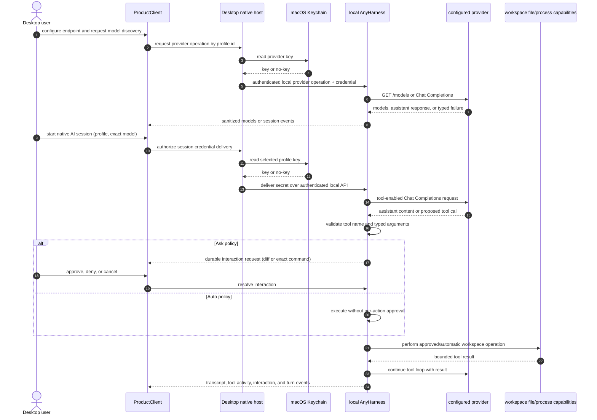

Description: Add a Desktop-local first-party coding agent for OpenAI-compatible Chat Completions endpoints, separate from ACP.
Date: 2026-10-17

# Native OpenAI-Compatible Coding Agent

## 1. Orientation

Desktop users can configure OpenAI-compatible providers for local OpenCode
sessions, and can register custom ACP agents, but there is no first-party
coding-agent loop that talks directly to a provider endpoint. This decision
adds that loop to the local AnyHarness runtime. It is distinct from ACP:
provider configuration selects an LLM endpoint and model, while the new
runtime-owned agent loop supplies coding behavior and workspace tools.

The first release is Desktop-local only. It does not restore cloud execution.
The agent runs in the existing local workspace, uses the existing session
record and transcript, and can read and edit workspace files and run terminal
commands. Users choose a provider and one of its discovered models. A model
must support OpenAI-compatible Chat Completions tool calls to perform coding
tasks; unsupported models produce a clear error rather than falling back to
ACP or another model.

### Goals

1. Let a user configure any OpenAI-compatible Chat Completions endpoint with a
   display name, base URL, and optional API key, independently of ACP.
2. Discover available models from the configured endpoint's `/models`
   resource, with explicit refresh and visible errors.
3. Run a first-party coding agent in a local AnyHarness session using the
   selected provider and model, with a tool-call loop for workspace file
   reads, edits, and terminal commands.
4. Persist provider secrets only in macOS Keychain. Provider keys and provider
   requests never pass through Proliferate's server.
5. Support an **Ask** policy and an **Auto** policy for both file edits and
   terminal commands. Ask is the default; Auto clearly warns that commands
   have the full access of the user's macOS account.
6. Reuse the existing session event log, transcript, pending-interaction, and
   cancellation surfaces wherever their contracts fit.
7. Preserve all existing ACP and native-harness behavior.

### Non-goals

- Cloud workspaces, cloud execution restoration, or cloud delivery of provider
  credentials.
- A provider-specific API other than OpenAI-compatible Chat Completions in
  the first version. Responses API support is deferred.
- ACP registration or an ACP adapter for this first-party agent.
- Arbitrary third-party extensions, plugins, shell tools, or user-defined
  tool schemas.
- Continuous local/cloud folder synchronization or repository upload.
- The broader requested marketplace, themes, system fonts, and RAG features.
  They remain separate product work and do not block this slice.
- Sandboxing Auto-mode terminal commands. Auto explicitly runs with the
  permissions available to the local runtime process.

### Requirements

1. Provider profiles have a stable local identifier, display name, normalized
   endpoint URL, API format (`chat_completions`), optional secret reference,
   and the last successfully discovered model list. A profile's secret value
   is never returned to the frontend.
2. Provider API keys are stored as distinct macOS Keychain items keyed by
   provider-profile identifier. Keychain read, write, and delete failures are
   surfaced to the user. A missing key is valid for unauthenticated endpoints.
   Setting or replacing a key uses a native macOS secure text prompt; the
   entered value is written to Keychain in Rust and is never held in React or
   returned to JavaScript. Clearing a key is a separate explicit action.
3. Model discovery makes an authenticated `GET` to the endpoint's `/models`,
   parses model identifiers without inventing aliases or defaults, and
   replaces the cached list only on a successful response. Authentication,
   network, timeout, malformed-response, and empty-model outcomes are
   distinguishable.
4. A model selection is an exact `(provider profile, model id)` pair. There
   is no silent provider, model, or ACP fallback.
5. A native AI session is represented by the existing durable session and
   transcript contracts, but its driver is not an ACP connection. Its
   OpenAI-compatible request, tool-call validation, tool execution, and
   response lifecycle are owned by the first-party runtime agent loop.
6. The initial tool set is fixed and typed: list/read/search workspace files,
   propose a workspace-relative file edit, and run a command in the workspace.
   Paths for file operations are validated using the runtime's workspace file
   safety rules; the `.git` directory and paths outside the workspace are
   inaccessible through file tools.
7. Ask mode requires approval for every proposed file mutation and every
   terminal command. File approval presents the exact diff; command approval
   presents the executable, arguments, and working directory. A denied or
   dismissed action is not executed and is reported to the model as a denied
   tool result. Read-only workspace tools do not prompt.
8. Auto mode performs proposed file mutations and terminal commands without
   per-action approval. Enabling Auto requires an explicit acknowledgement
   that terminal commands run with the full permissions of the macOS user
   running Proliferate. The warning remains visible while Auto is selected.
9. Ask/Auto is a Desktop-local user preference persisted through the existing
   preference lifecycle and Desktop ProductStorage, never synchronized to the
   Proliferate server. It defaults to Ask and applies to new and existing
   native AI sessions. A preference change must not alter an in-flight tool
   action's already-made authorization decision.
10. Provider credentials are read from Keychain by the Desktop native host
    and delivered to the local runtime over its authenticated local API only
    for a selected session or model-discovery request. Runtime memory is the
    only runtime-side credential lifetime. Credentials are not written to
    session state, transcripts, terminal environments, logs, telemetry, or
    Proliferate server requests.
11. Requests send the user's prompt and only the workspace context selected
    or read by the agent to the configured provider. The UI explains this
    endpoint data-sharing boundary during provider setup.
12. Provider URLs must use HTTP or HTTPS and have no embedded user-info.
    Authentication-bearing requests do not follow cross-origin redirects.
    Local and LAN endpoints remain usable as explicitly configured by the
    user; the UI identifies that requests go directly to the configured
    endpoint.
13. Cancellation stops an active model request and terminates an active
    command process before the session reports the turn as cancelled. A
    cancelled or stale approval cannot later authorize a tool call.
14. Provider, model, protocol, permission, tool, and cancellation failures
    produce sanitized, typed session events or interaction outcomes; secret
    values and raw authorization headers never enter public errors.
15. The implementation updates the README in the same shipping PR to
    distinguish native AI agents from ACP agents and to document provider
    setup, model discovery, approval modes, and local credential handling.

## 2. Current Context

### Desktop and ProductClient

Desktop is a thin native host around ProductClient and a local AnyHarness
sidecar. The product client already provides settings, chat launch selection,
session controls, preference persistence, and the visible interaction flow.
Native keychain operations live in
[keychain.rs](../apps/desktop/src-tauri/src/commands/keychain.rs). Today that
module stores the AnyHarness data-encryption key in Keychain but stores other
recreatable credentials in owner-only files. This feature deliberately adds
provider-profile Keychain entries instead of using the existing environment
secret file. The native keychain command boundary must not expose provider
secret values to React.

Custom OpenAI-compatible provider configuration currently lives under
**Settings → Agents → OpenCode → Providers** and is rendered into OpenCode
configuration for local OpenCode sessions. That remains unchanged. The new
native provider profile surface is separate from that harness-specific
configuration; provider records must not masquerade as ACP registrations or
OpenCode provider settings.

The README currently explains this OpenCode-only scope and custom ACP
registration. Its description is correct for current behavior until this
feature ships.

### AnyHarness sessions and workspace capabilities

The runtime's durable session store and `SessionEventEnvelope` are the source
of transcript truth. Sessions currently start an ACP-backed process. Session
interactions already support durable permission requests, user decisions,
cancellation, and replay; these are candidates for the first-party loop to
reuse through an agent-neutral interaction facade rather than by creating an
ACP connection.

Workspace file access already has path-safety rules in
[safety.rs](../anyharness/crates/anyharness-lib/src/adapters/files/safety.rs).
Terminal process execution is available through
[run.rs](../anyharness/crates/anyharness-lib/src/adapters/processes/operations/run.rs).
The process runner resolves its working directory inside the workspace and
removes runtime-private environment variables, but the child is not
OS-sandboxed and otherwise has the permissions of the runtime process. The
feature must preserve that fact in the Auto warning and must not imply that a
workspace working directory is a security sandbox.

The current ACP permission request path is implemented by
[permission.rs](../anyharness/crates/anyharness-lib/src/live/sessions/driver/inbound/permission.rs).
It routes permission interactions over the session event stream and rendezvous
broker. The first-party driver must not depend on ACP request/response types;
it should reuse or extract the session-owned, protocol-neutral interaction
contract. If that boundary cannot be reused without making non-ACP session
execution depend on ACP, the existing event contract should be extended
without changing ACP semantics.

### Existing credentials and provider configuration

The encrypted session binding implementation at
[crypto.rs](../anyharness/crates/anyharness-lib/src/domains/sessions/mcp_bindings/crypto.rs)
uses the runtime data key, but it does not provide a desktop provider
credential vault. This ADR chooses direct Keychain storage for native AI
provider keys, per the user decision. Keychain access identity can change
across re-signing or app identity changes; affected users may need to re-enter
their keys. There is no server-side provider credential contract in this
feature.

### Product boundaries

- **Harnesses** owns ACP registrations, agent kinds, and launch readiness:
  [harnesses](../specs/systems/harnesses/README.md).
- **Agent auth** owns existing managed/native harness credential routing:
  [agent auth](../specs/systems/agent_auth/README.md). Provider profiles in
  this ADR are local runtime configuration for the new first-party agent,
  not harness-auth selections.
- **Sessions** owns durable records, events, cancellation, and interactions:
  [sessions](../specs/systems/sessions/README.md).
- **Workspaces** owns file and process capabilities:
  [workspaces](../specs/systems/workspaces/README.md).
- **Desktop host** owns macOS Keychain and sidecar lifecycle:
  [desktop host](../specs/systems/desktop-host/README.md).
- **Chat** and **workspace surface** render session events and controls but do
  not own provider or agent-loop behavior:
  [chat](../specs/systems/chat/README.md) and
  [workspace surface](../specs/systems/workspace-surface/README.md).

## 3. External Systems and Spikes

### OpenAI-compatible Chat Completions

The provider contract for this slice is a base URL, optional bearer API key,
`GET /models`, and Chat Completions requests with `tools` and tool-call
responses. Provider implementations differ in URL conventions, authorization
requirements, error bodies, and feature support. Configuration stores the base
URL as entered after normalization; request construction must not append
duplicate `/v1` segments or silently rewrite a provider's path.

`/models` is discovery, not capability proof. Providers generally do not
advertise tool support in a portable way, so configuration cannot guarantee a
selected model supports tool calls. The first tool-enabled completion is the
capability check. An unsupported response is a clear session failure with
recovery guidance to select a compatible model or endpoint. It never switches
to a different model.

The runtime must cap connection and response time, response size, tool-call
count per completion, argument size, and total tool-loop iterations. Provider
error bodies are parsed only for safe public categories; response bodies and
authorization headers are not logged or surfaced verbatim.

### Provider URL trust boundary

The native runtime sends requests directly from the user's Mac to a URL the
user configured. It is not a server-side SSRF surface. Still, credentials
must not be disclosed by URL parsing mistakes or redirects: accept only HTTP
and HTTPS URLs without embedded credentials, attach the API key as an
authorization header, do not follow cross-origin redirects for authenticated
requests, and redact endpoint query values in diagnostics. The user-selected
provider is trusted with prompts and any workspace context the agent reads.

### Required implementation spike

Before committing to the first implementation slice, prove a thin vertical
path with a local mock OpenAI-compatible server:

- discovery parses `/models` identifiers and rejects malformed payloads;
- a tool-enabled Chat Completions request returns a validated tool call;
- auth headers are not forwarded across redirects and do not appear in test
  diagnostics;
- the runtime can park and resume a tool call through a protocol-neutral
  session interaction and cancel it without executing the action.

This is a test fixture/spike within implementation, not a retained throwaway
feature branch. If the protocol-neutral interaction cannot safely reuse the
current session broker, stop and amend this ADR before implementation expands.

## 4. Design

### Preferred design

Add a first-party, local-only native AI driver inside AnyHarness and keep the
session contract independent of its provider protocol. A provider profile is
local configuration; a session selects one profile and model. The Desktop
native host mediates Keychain access, and the AnyHarness driver performs
provider requests and tool orchestration. The driver uses the session's
durable event sink and cancellation lifecycle, and calls existing workspace
file/process capabilities instead of inventing a second filesystem or shell.

The session creation contract gains an explicit driver/agent identity and
provider/model launch selection. ACP sessions continue through their existing
path. Native AI sessions have a first-party driver that implements prompt,
tool-call, result, and turn lifecycle without opening an ACP subprocess. A
shared protocol-neutral session interaction facade owns pending approval,
resolution, cancellation, persistence, and replay. ACP permission requests
adapt into that facade; the native driver requests the same permission
semantics for file edits and terminal commands.

The provider key is not put in a process environment. The native host reads a
Keychain item by an opaque profile id, passes the value only to the local
runtime operation that needs it, and drops its copy when the operation ends.
The runtime holds the key only in a redacted, session-scoped in-memory
credential lease for provider HTTP authentication and revokes it on session
close or sidecar shutdown. Provider profiles and model identifiers are
persisted locally in Desktop ProductStorage without the secret. A Keychain
item failure is explicit; no plaintext-file fallback is allowed.

The initial tool registry is closed and typed. The runtime validates every
provider-supplied call before it reaches a capability. Reads are workspace
relative and use the existing safe file service. Edits are converted to a
concrete diff before authorization; approval applies only to that exact diff
and workspace version. Commands are parsed as a program plus argument list,
not interpolated into a shell string. Ask mode shows that exact executable,
arguments, and cwd before spawning. Auto mode calls the process capability
without approval, while the UI persistently warns that command behavior is
not confined to the workspace.

Prompt, assistant, tool-call, tool-result, approval, and failure records use
existing event vocabulary where it semantically matches. Any new event shape
must be added to the versioned contract and generated SDKs, with secret
redaction at event construction and persistence. Provider request/response
payloads are never copied wholesale to the event log.

### Alternatives considered

1. **Implement a thin ACP agent adapter for each provider.** Rejected:
   provider configuration and model selection are not ACP agents; wrapping
   this first-party loop as ACP would couple product behavior to a transport
   and obscure the separate user concept.
2. **Route OpenCode through provider profiles.** Rejected for this slice:
   it would improve provider setup but retain dependence on an installed
   harness and its model/tool semantics, which does not deliver the requested
   independent first-party agent.
3. **Run provider requests in the Desktop frontend.** Rejected: it exposes
   secret-handling behavior to the webview and duplicates conversation/tool
   orchestration outside the session record and cancellation owner.
4. **Persist provider keys in an encrypted local file protected by the
   runtime data key.** Rejected by user preference in favor of direct Keychain
   storage. Re-entry after a Keychain ACL/signature change is accepted.
5. **Auto as the initial approval default, or silently fall back when tool
   calls fail.** Rejected: Ask is the default; unsupported tools and failed
   requests are explicit failures.

### Assumptions and fixed decisions

- The first-party agent is local-only and runs against the selected local
  workspace. Cloud execution restoration is not part of this ADR.
- New sessions are available in the Desktop app only; no Web or Mobile UI
  work is included.
- New provider profiles are separate from the existing OpenCode custom
  provider configuration and from custom ACP agent registrations.
- API keys are optional and stored directly in macOS Keychain. A later
  Keychain identity change may require re-entry.
- Chat Completions is the only request format in the first slice. Responses
  API support is a later decision.
- Ask/Auto is one Desktop-local user-level preference shared by native AI
  sessions. The setting defaults to Ask, is persisted through Desktop
  ProductStorage without a server round-trip, and is not an ACP permission
  setting.
- Ask authorizes one exact mutation or command, not an open-ended session
  grant. Reads do not prompt.
- Auto's terminal access is equivalent to the local runtime process's
  macOS-user access. There is no claim of filesystem or OS sandboxing.
- Requests go directly to the configured endpoint. The provider may receive
  prompts and workspace context read by the agent.
- A user-configured endpoint may be on localhost or the LAN. Authenticated
  requests do not follow redirects to another origin.

## 5. New and Modified Primitives by Boundary

The exact module names are assigned during implementation after the spike,
but ownership is fixed here.

### Desktop native host

- Add Keychain CRUD for provider-profile credentials. Account names use an
  opaque stable profile id; service names are app-scoped. Native commands
  expose a native secure key-entry prompt, delete, and credential-mediated
  provider operations, never a secret getter or key setter accepting a
  JavaScript string.
- Keep provider credentials out of versioned contracts and generated
  ProductClient SDKs. Native credential mediation uses a dedicated header on
  authenticated local-runtime requests; the runtime must exclude that header
  from request logging and tracing.
- Keep provider-profile metadata in Desktop ProductStorage: stable opaque
  profile id, name, normalized endpoint, exact cached model ids, refresh
  timestamp, and non-secret key-presence state. The Desktop host resolves a
  profile id to its endpoint before invoking native discovery. No provider
  profile or credential record is added to the server or runtime database.
- Extend the authenticated Desktop-to-sidecar bridge so provider discovery
  and session credential delivery are initiated by native code and scoped to
  a local runtime session. Do not pass the provider key as a command-line
  argument or environment variable.
- Return typed, sanitized errors for Keychain lock/access failure and
  provider discovery failure.

### AnyHarness contract and runtime

- Define a first-party agent identity distinct from ACP harness kinds; accept
  exact provider-profile and model identifiers at session creation.
- Add local durable metadata for provider profiles/model discovery only if
  required by runtime authority; never persist the key value or a recoverable
  credential copy in SQLite, JSON state, event payloads, or workspace files.
- Add the OpenAI-compatible Chat Completions client and bounded tool-call
  loop, with no ACP dependency in the first-party driver.
- Provide protocol-neutral turn and interaction hooks so the driver can
  publish existing session events, park for approval, resume after a decision,
  and observe cancellation.
- Add a closed tool registry over workspace list/read/search/edit and
  process-run capabilities. Tool-call arguments are schema-validated and
  bounded before capability invocation.
- Reuse runtime workspace path checks and environment stripping. Provider
  secrets are never inherited by command execution.

### Session contracts and event stream

- Extend session creation to carry native-agent identity plus provider/model
  selection without weakening existing target-observed launch validation for
  ACP harnesses.
- Reuse existing interaction request/resolve semantics for approval where
  they are already protocol-neutral; otherwise add a native-agent-safe
  interaction source while preserving ACP wire compatibility.
- Keep event payloads structured and bounded. Tool activity is visible, but
  raw provider payloads, authorization headers, keys, and unfiltered terminal
  output do not become secret-bearing metadata.

### ProductClient / Desktop UX

- Add a Desktop-only provider setup and management surface with name, endpoint,
  optional key, model discovery/refresh, and clear connection/model errors.
- Add native AI agent selection to the existing new-session flow without
  listing it as an ACP registration or installed harness.
- Add Ask/Auto preference using the existing preference lifecycle and
  Desktop ProductStorage. Ask is selected on first use. Auto requires an
  acknowledgement and leaves its full-macOS-account-access warning visible
  while enabled. This preference is not sent to the server; Desktop
  synchronizes it to active local runtime sessions over the authenticated
  native bridge, and a failed update leaves the affected runtime session in
  Ask until synchronization succeeds.
- Ask approval shows the exact file diff or executable, argument list, and
  working directory. Stale, duplicate, denied, or cancelled approvals cannot
  authorize execution.
- Explain that prompts and agent-read workspace context are sent to the
  selected provider.
- Update [README.md](../README.md) in the implementation PR, after behavior
  exists and can be documented as current.

### Server

- No server-side provider table, provider key, endpoint proxy, or provider
  route is added. Existing control-plane and custom OpenCode provider
  behavior remains unchanged.

## 6. Flows

### Configure a provider and discover models

1. The user adds a named endpoint in Desktop settings.
2. Desktop validates HTTP(S) and rejects URL user-info. If the user chooses
   to set a key, the settings surface opens a native macOS secure text prompt;
   Rust writes its value directly to the profile's Keychain item. Provider
   metadata contains only the opaque key reference/key-presence bit. The
   WebView never receives the entered value.
3. Desktop asks the local runtime to perform `/models` discovery. Native code
   mediates the Keychain read and scoped secret delivery; the runtime requests
   the endpoint directly.
4. On success, available model identifiers are displayed and cached as
   non-secret profile metadata. A failed refresh preserves the prior known
   list while showing that it is stale and why refresh failed.
5. The user selects an exact profile/model pair for a new native AI session.

### Run a coding turn

1. Desktop validates that the selected profile and exact model exist in its
   local provider metadata. Runtime session admission validates the native
   driver identity and bounded, non-empty opaque profile/model identifiers;
   it does not query a server-side provider registry. It writes the ordinary
   durable session record without starting ACP.
2. Desktop native code reads the selected Keychain item and delivers it to the
   authenticated local runtime using the native-only credential operation.
   The native driver starts only after delivery succeeds, or Desktop confirms
   that this profile is intentionally keyless; delivery failure fails the
   pending session visibly.
3. The runtime begins a bounded Chat Completions request with the prompt and
   necessary conversation history.
4. Assistant text and tool-call status are normalized into the session event
   stream. Tool calls not present in the closed tool registry fail visibly
   without execution.
5. For read operations, the runtime executes a workspace-scoped read and
   returns a bounded result to the model.
6. For edits or commands, the runtime applies the saved Ask/Auto preference,
   synchronized from Desktop over the authenticated local bridge. A failed
   update keeps active runtime sessions in Ask.
   In Ask, it emits a pending interaction and waits; approval applies the
   exact proposed edit or runs the exact command once. Denial is returned to
   the provider as a denied tool result. In Auto, it executes directly and
   makes the Auto warning visible in the product surface.
7. The result is returned to the model for the next bounded loop iteration.
   The turn ends on a provider final answer, explicit failure, iteration
   bound, or cancellation.

### Failure and recovery

| Condition | User-visible outcome | Recovery |
| --- | --- | --- |
| Keychain item missing or inaccessible | Provider/session setup reports credential unavailable; no request is attempted | Re-enter/save the key or unlock/repair Keychain access |
| `/models` unauthorized, unavailable, timed out, or malformed | Typed discovery error; existing model cache is retained and marked stale | Correct URL/key or retry |
| Selected model rejects tool calls or returns unsupported tool format | Session error names unsupported tool calling; no fallback occurs | Select another discovered model or provider |
| Invalid/unknown tool name or malformed/oversized arguments | Tool call is rejected and a safe failure is returned to the model; repeated invalid calls end the turn with a visible error | Correct the prompt/model; no executable action occurs |
| File edit cannot be safely resolved or its workspace version changed | Edit is refused; no partial write; user sees conflict/error | Review current file and ask agent to regenerate diff |
| Ask interaction is denied, dismissed, stale, or cancelled | Tool is not executed; denial/cancellation is recorded and returned | Agent may continue only from the safe denial result; user may submit a new prompt |
| Command fails or exceeds runtime timeout | Bounded output and exit status appear as tool result; the process is terminated at timeout | Inspect command and explicitly retry |
| Provider redirects, returns an error, or returns an invalid completion | Sanitized typed provider error; no cross-origin credential forwarding | Correct endpoint/model or retry |
| User cancels while request/tool is active | Request is aborted; active process is terminated; no later interaction resolution runs it | Start another turn |
| Desktop/sidecar bridge is unavailable | Session creation or provider operation fails visibly; no credential is written elsewhere | Restart/reconnect the local runtime |

### Compatibility and migration

- Existing OpenCode custom provider records continue to render into OpenCode
  as before.
- Existing ACP custom-agent registration, session creation, and ACP
  permission requests continue to use their current paths.
- Existing user preference documents migrate by adding the Ask/Auto key with
  default `ask`; unknown values resolve to Ask through the existing
  preference migration contract.
- The new native agent identifier does not claim an existing ACP harness
  identity or alter catalog/readiness authorization.
- Keychain items are independent of the old `env-secrets.json`; no secret is
  migrated automatically from an environment variable or local file. The user
  explicitly enters the key into the new profile.

## 7. Failure Modes, Tests, and Observability

### Test plan

Use the repository's testing tiers from
[testing](../specs/engineering/testing/README.md).

- **Tier 1, unit:** endpoint normalization and URL policy; `/models` parsing;
  Chat Completions parsing; model/tool capability errors; typed tool-argument
  validation; Ask/Auto policy; exact-diff/version checks; preference default
  and migration; redaction of keys, headers, URL query values, and provider
  error bodies.
- **Tier 2, rendered/integration:** provider settings form, refresh and stale
  state, native agent selection independent from ACP, Ask approval UI with
  exact diff/command, explicit Auto acknowledgement and persistent warning,
  denied/cancelled/stale interactions, and model/provider errors in the
  transcript.
- **Tier 2, runtime integration:** local mock provider exercises discovery,
  multi-step tool calls, streamed assistant output, file read/edit, command
  execution, tool result return, key delivery lifetime, cancellation, timeout,
  and session replay.
- **Tier 3, contract:** session creation and event fixtures round-trip through
  AnyHarness contracts and generated SDKs; legacy ACP event fixtures remain
  byte-compatible where required.
- **Tier 4, manual Desktop:** add an unauthenticated local provider and an
  authenticated test provider; verify Keychain persistence across restart,
  Ask and Auto behavior, cancellation, no server network request containing
  provider credentials, and unchanged ACP/OpenCode sessions.

The exact tests and tier selection are confirmed against the testing spec
during implementation. No live provider credential belongs in fixtures.

### Observability

- Emit structured, secret-free outcomes for provider discovery, provider
  request completion/failure category, tool validation/execution/denial, and
  cancellation, keyed by session id and provider-profile id (not endpoint
  query, API key, or prompt content).
- Do not capture prompts, full provider response bodies, raw tool arguments,
  terminal output, authorization headers, or Keychain values in product
  telemetry.
- Local logs identify provider operation category, duration, HTTP status class,
  model id, tool name, and typed error. Any endpoint value included in an
  error must omit credentials and query values.
- No new server dashboard or alert is required because requests remain local
  and no server-side provider service is added.

## 8. High-Level Sequencing

The implementation is a vertical PR ladder; every entry receives its own
frozen delivery spec under `delivery/`. This ADR is the working decision and
is committed only with the final ladder PR, per
[the ADR procedure](../guides/process/adrs.md).

1. **Native provider profiles and model discovery.** Add Desktop Keychain
   profile credentials, non-secret provider metadata, authenticated
   `/models` discovery, settings UX, tests, and error states. Gate: explicit
   user configuration; no change to the current OpenCode provider path.
   Revert: remove the new settings/runtime profile surface and its
   profile-scoped Keychain entries through an explicit cleanup path.
2. **Protocol-neutral native session and tool loop.** Add first-party local
   driver, Chat Completions, session event integration, workspace read tools,
   fixed tool validation, cancellation and provider failure handling. Gate:
   not selectable until the local mock-provider contract tests pass. Revert:
   hide/remove the native driver selection; existing ACP sessions remain
   unchanged.
3. **Approval policy and mutation tools.** Add file-edit diffs, terminal
   command tool, durable Ask interactions, saved Ask/Auto preference,
   explicit Auto warning, and permission/cancellation tests. Gate: Ask
   default; Auto requires acknowledgement. Revert: disable mutating native
   tools; retain read-only provider chat if the runtime contract safely
   supports that fallback, otherwise hide the native agent entry.
4. **Desktop release proof and README.** Complete Desktop manual QA, regression
   proof for ACP/OpenCode, credential/log review, README feature and setup
   documentation, and commit this ADR with the final ladder PR. Gate: release
   only after documented desktop checks pass. Revert: revert user-facing
   native-agent entry and profile UI without changing existing ACP/provider
   records.

Canonical documentation updated as behavior lands:

- `specs/systems/sessions/README.md` — native session driver, event and
  interaction ownership.
- `specs/systems/agent_auth/README.md` or a clearly fenced sibling section —
  only if the implementation demonstrates that agent_auth owns this local
  provider-profile credential flow; otherwise keep the profile contract under
  the owning new/expanded runtime system spec.
- `specs/systems/harnesses/README.md` — only if its current ownership of
  supported agent kinds changes; ACP registrations remain harness-owned.
- `specs/systems/settings/README.md` — provider and execution-permission
  settings surface.
- `specs/systems/chat/README.md` — transcript/interaction consumption only.
- `specs/areas/anyharness.md`, `specs/areas/frontend.md`, and
  `specs/systems/desktop-host/README.md` — source placement and bridge changes.
- `README.md` — user-facing current setup and explicit distinction among
  native AI agent, harness, and ACP agent.

## 9. Appendix

- [README](../README.md) — current product description and provider setup.
- [Architecture](../specs/ARCHITECTURE.md) — client, control-plane, execution
  plane, and gateway seams.
- [AnyHarness area](../specs/areas/anyharness.md) — runtime ownership and
  layering.
- [Frontend area](../specs/areas/frontend.md) — ProductClient access and
  preference boundaries.
- [Desktop host](../specs/systems/desktop-host/README.md) — native shell and
  sidecar seam.
- [Agent auth](../specs/systems/agent_auth/README.md) — current credential
  boundary; this design intentionally does not use its cloud vault.
- [Harnesses](../specs/systems/harnesses/README.md) — ACP and managed harness
  ownership.
- [Sessions](../specs/systems/sessions/README.md) — durable session and event
  invariants.
- [Chat](../specs/systems/chat/README.md) — transcript and interaction
  presentation.
- [Workspaces](../specs/systems/workspaces/README.md) — runtime file and
  process capabilities.
- [Settings](../specs/systems/settings/README.md) — settings composition
  surface.
- [Testing](../specs/engineering/testing/README.md) — proof tiers.
- [ADR procedure](../guides/process/adrs.md) — decision lifecycle.
